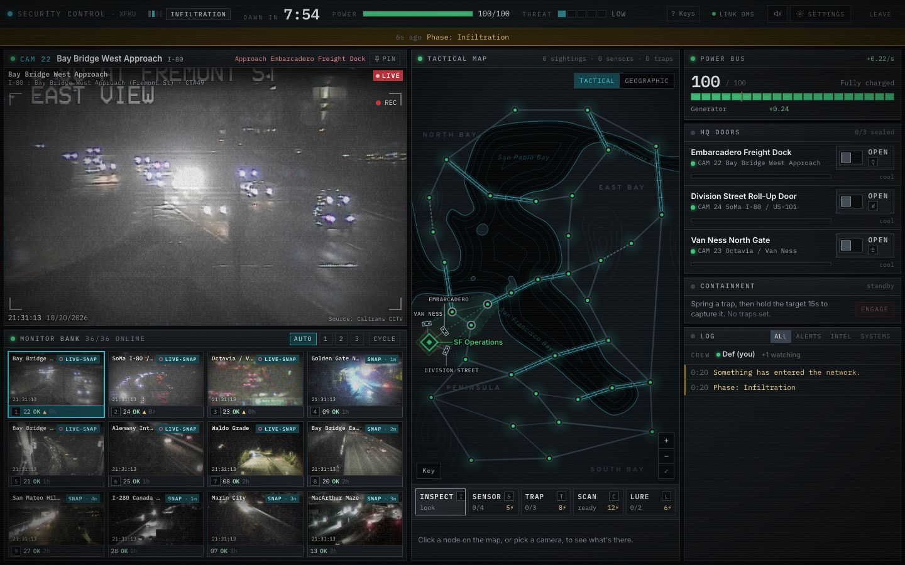
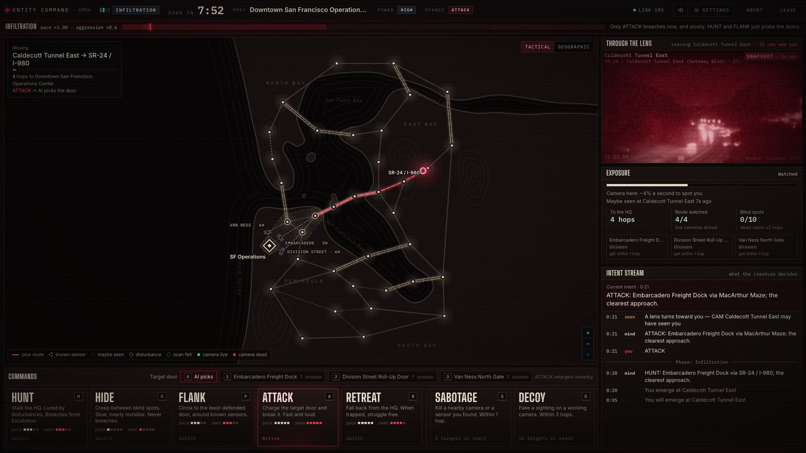
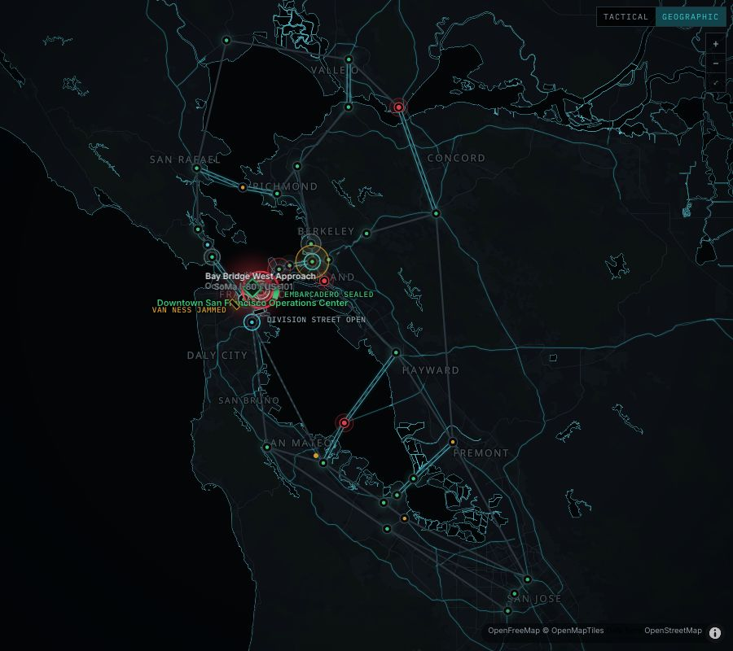
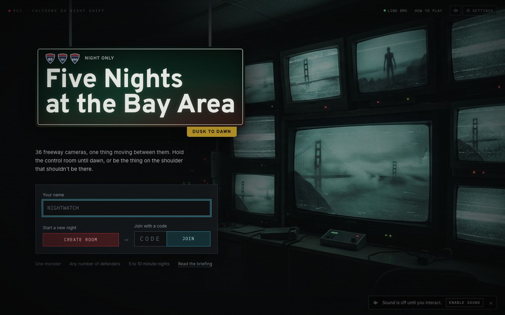
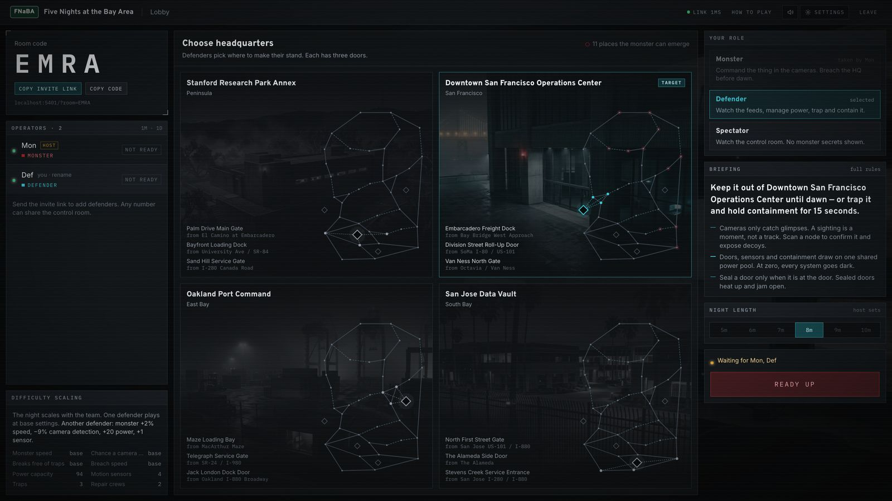
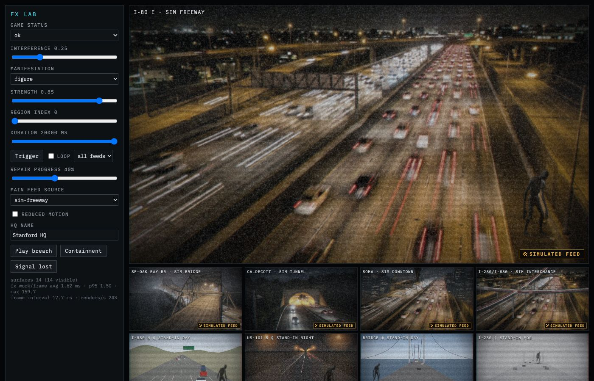
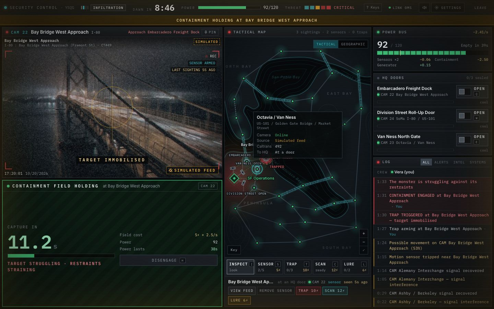
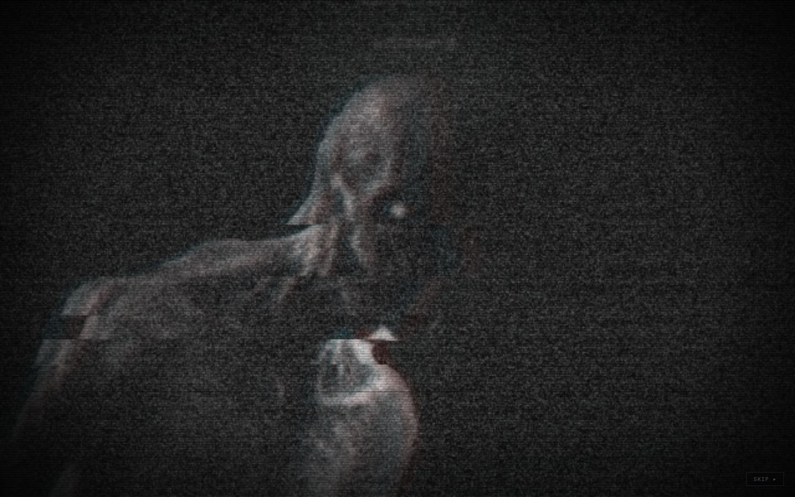
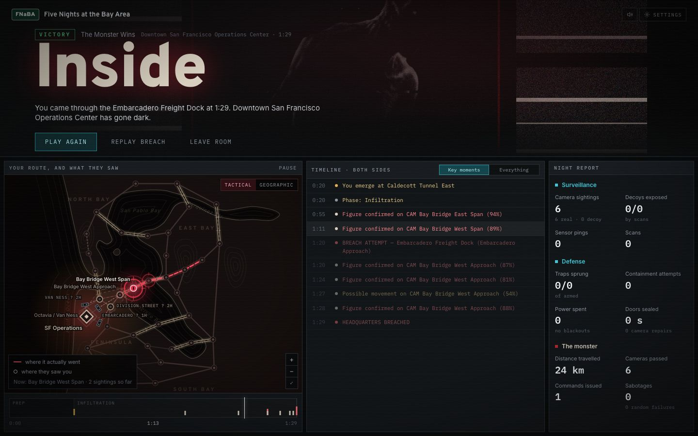
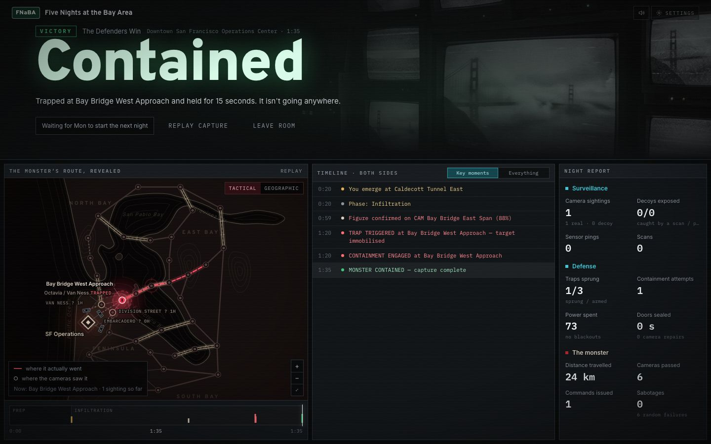

# Five Nights at the Bay Area

An asymmetric multiplayer horror game that runs in the browser, played on a graph of 36 real Caltrans freeway cameras around the San Francisco Bay Area. One player is the **Monster** and gives strategic orders to an AI creature that walks the freeways. Everyone else is a **Defender** in a shared CCTV control room, watching the feeds and spending one power budget on doors, sensors, traps and scans. Hold the headquarters until dawn, or trap the thing and hold it for 15 seconds.



## Features

- **Two roles with separate interfaces.** Defenders get a dense multi-monitor control room: main feed, 12-tile monitor bank, power bus, doors, containment, team log. The Monster gets a dark command deck: stances, targeted abilities, "through the lens" view, exposure readout and an intent stream. Spectators can watch the control room, with no monster secrets shown.
- **Real cameras, honestly labelled.** The server health-checks the curated Caltrans cameras and shows LIVE (HLS video), SNAPSHOT (still with its age) or SIMULATED imagery. A dead camera or no internet at all never stops a match.
- **Monster AI.** Server-side tactical brain with A* pathfinding over travel time and camera exposure. The player picks the stance (HUNT, HIDE, FLANK, ATTACK, RETREAT) and abilities (SABOTAGE, DECOY); the AI chooses the route.
- **Two maps.** A tactical SVG map (threat heat, door heat, sightings, routes) and a geographic MapLibre map on OpenFreeMap tiles.
- **Camera FX and audio.** Canvas CCTV noise, tears, interference, monster compositing into each camera's frame, and breach, containment and signal-lost cinematics. All audio is procedural Web Audio, with master volume, mute and a reduce-flashing option.
- **Multiplayer.** 4-letter rooms and invite links, host migration, reconnection within a grace period, forfeits, spectators and restart to lobby. The server is authoritative, and per-role views make information hiding a tested property.

## Quick start

Requires Node.js 20+ and npm.

```bash
npm install
npm run dev
```

- Client: http://localhost:5175 (Vite proxies `/api` and `/socket.io`)
- Server: http://localhost:3001 (`/api/health`, `/api/cameras`, Socket.IO)

**Solo with two tabs:** each tab is its own player (the session token lives in `sessionStorage`). In tab 1 create a room and stay Monster (the room creator is host and Monster by default). In tab 2 join with the 4-letter code and take Defender. A defender picks the headquarters, both tabs ready up, and the night starts after a 5 second countdown. No network is needed with `CAMERA_MODE=simulation npm run dev`.

## How to play

A night is 5 to 10 minutes (default 8) with a 20 second preparation, then three phases: Infiltration, Escalation, Final Assault. The monster is faster and breaches faster as the night goes on.

**Defenders** (shared power pool, all actions cost power):
- Watch the feeds. A camera only catches a glimpse; a sighting is a moment, not a track.
- Place motion sensors and traps (during preparation too), close the three HQ doors (sealed doors drain power and heat up), repair sabotaged cameras, scan a node to confirm a sighting and expose decoys, lure the monster with an alarm.
- When a trap catches the monster, engage containment and hold it for 15 uninterrupted seconds to win. Power at zero causes a 12 second blackout.
- Defenders win at dawn or by capture.

**Monster:**
- Pick a spawn and an opening stance in preparation, then change stance or target a door during the night. SABOTAGE kills a nearby camera or a sensor you found; DECOY fakes a sighting.
- You see the graph, camera status and what you have discovered, never traps or exact power. A breach of the HQ wins.
- If trapped, RETREAT starts a continuous struggle against the restraints.

Rules and numbers: [docs/MECHANICS.md](docs/MECHANICS.md). The in-game "How to play" sheet and `?` help have the same summary.

### Controls

| Defender | |
| --- | --- |
| `1`-`9`, arrow keys | Show monitor on the main screen, move through the bank |
| `[` `]`, `O` | Previous / next bank page, auto-cycle pages |
| `P`, `V`, `R` | Pin the main camera, view latest sighting, repair the main camera |
| `Q` `W` `E` | Seal / open doors 1-3 |
| `H` | Engage / disengage containment |
| `I` `S` `T` `C` `L` | Map tool: inspect, sensor, trap, scan, lure |
| `Esc`, `?` | Back to inspect, show the shortcut sheet |

| Monster | |
| --- | --- |
| `H` `C` `F` `A` `R` | HUNT, HIDE, FLANK, ATTACK, RETREAT |
| `S`, `D` | SABOTAGE, DECOY (then click a target on the map, `Enter` to confirm) |
| `0`-`3` | Target door: AI picks, or door 1-3 |
| `Space` | While trapped: struggle (RETREAT) |
| `Esc` | Cancel targeting |

<details><summary>More screenshots</summary>




</details>

## Camera modes

`CAMERA_MODE` selects how real imagery is used. Real camera trouble never stops a match; cameras degrade to SIMULATED on their own.

| Mode | Behaviour |
| --- | --- |
| `auto` (default) | Polite health checks. LIVE HLS where verified, else SNAPSHOT, else labelled SIMULATED. |
| `live` | Like `auto`, but only cameras with a verified live stream show real imagery; the rest are SIMULATED. |
| `snapshot` | Stills only; HLS is never probed. |
| `simulation` | Fully offline. Every feed is the labelled procedural simulation and no external request is made. A full match is playable. |

Badges show the real source state, never the fictional in-game sabotage:

- **LIVE** - HLS video is actually playing (enlarged main feed only).
- **SNAPSHOT** - a Caltrans still, with its age (`SNAP - 2m`). Thumbnails of live-capable cameras show `LIVE-SNAP`.
- **SIMULATED** - dashed amber, a procedural stand-in. Never styled like live.

Caltrans data notes, usage terms, measured availability and the classification heuristics are in [docs/CAMERAS.md](docs/CAMERAS.md). Ops view: `/api/cameras?detail=1` and `/api/health`.

## Scripts

All exist in the root `package.json`.

| Command | What it does |
| --- | --- |
| `npm run dev` | Server (tsx watch, port 3001) and client (Vite, port 5175) together |
| `npm run build` | Build `client/dist`, then build/typecheck the server |
| `npm start` | Serve the built client, API and Socket.IO from one port (`$PORT`, default 3001) |
| `npm test` | Vitest unit and integration tests (`vitest run`) |
| `npm run test:watch` | Vitest in watch mode |
| `npm run test:e2e` | Playwright end-to-end suite (own servers on 3101/5199 and 3102/5198) |
| `npm run typecheck` | Typecheck shared, server and client |
| `npm run balance` | Headless bot balance harness (see [docs/BALANCE.md](docs/BALANCE.md)) |

For e2e, run `npx playwright install chromium` once.

## Configuration

Copy `.env.example` to `.env` or set variables in the environment.

| Variable | Default | Purpose |
| --- | --- | --- |
| `PORT` | `3001` | Server port |
| `CAMERA_MODE` | `auto` | `auto`, `live`, `snapshot`, `simulation` |
| `CAMERA_CHECK_INTERVAL_MS` | `300000` | Per-camera re-check cadence |
| `CAMERA_TIMEOUT_MS` | `8000` | Probe timeout |
| `CAMERA_CONCURRENCY` | `3` | Max parallel probes |
| `CAMERA_REFRESH_MS` | `60000` | Suggested client snapshot refresh |
| `CAMERA_PROBE_ORIGIN` | unset | Test only: send probes to another origin to simulate an outage |
| `CORS_ORIGIN` | reflect origin | Comma-separated allowed Socket.IO origins when the client is hosted elsewhere |
| `API_PORT` | `3001` | Client dev server only: where to proxy the API |

## Architecture

```
client (React/Vite) <-socket.io-> server/net -> rooms -> engine (pure, deterministic)
        ^ per-role views                |                   |
        +------ visibility/ (anti-cheat projection)    ai/ (MonsterBrain)
                                   cameras/ (CameraService)
shared/  types, protocol, config (all balance numbers), graph, data
```

npm workspaces: `shared` (types, config, graph, camera and network data), `server` (Express, Socket.IO, engine, AI, visibility, cameras, balance harness) and `client` (React, Vite, Tailwind, zustand, hls.js, MapLibre). The engine is pure and seeded; the server sends each player a projected view, never the full state. Details: [docs/ARCHITECTURE.md](docs/ARCHITECTURE.md), [docs/CONTRACT.md](docs/CONTRACT.md), [server/src/ai/README.md](server/src/ai/README.md), [client/src/audio/README.md](client/src/audio/README.md).

## Testing

- **Unit/integration:** `npm test` ran 208 tests in 22 files, all passing (engine, visibility, pathfinding, rooms, AI, cameras, full-match simulation, audio, FX).
- **End-to-end:** `npm run test:e2e` ran 21 Playwright tests in 9 spec files, all passing: lobby, monster AI, defense, information hiding on the wire, outcomes, reconnect, disconnect, simulation-only cameras and a camera-outage server. See [e2e/README.md](e2e/README.md).
- **Balance:** measured with scripted bots, not humans. See [docs/BALANCE.md](docs/BALANCE.md).

Honest project status and known limitations: [docs/STATUS.md](docs/STATUS.md).

## Deployment

One Node process serves the built client, the API and Socket.IO. **Match state is in memory, so run exactly one instance** (no autoscaling, no round-robin replicas). Put it behind HTTPS with WebSocket upgrade preserved. A multi-stage `Dockerfile`, `render.yaml` and `fly.toml` are included; the Docker image has not yet been built locally. See [docs/DEPLOYMENT.md](docs/DEPLOYMENT.md).

## Documentation

[SPEC](docs/SPEC.md) | [STATUS](docs/STATUS.md) | [ARCHITECTURE](docs/ARCHITECTURE.md) | [MECHANICS](docs/MECHANICS.md) | [CAMERAS](docs/CAMERAS.md) | [BALANCE](docs/BALANCE.md) | [DEPLOYMENT](docs/DEPLOYMENT.md) | [CONTRACT](docs/CONTRACT.md)

## Credits and licensing

- **Camera data:** Caltrans CWWP2 District 4 feed. Per the Caltrans Conditions of Use, website information is in the public domain unless otherwise indicated, with a note that some content (for example photographs) may be copyrighted. The data is free to use; we read it, link to it and display it, we do not archive or commit Caltrans images, and every real feed is labelled with its source. See [docs/CAMERAS.md](docs/CAMERAS.md) section 2 (not legal advice).
- **Maps:** [OpenFreeMap](https://openfreemap.org) vector tiles, (c) OpenMapTiles, data (c) OpenStreetMap contributors, rendered with MapLibre GL.
- **Fonts:** self-hosted through `@fontsource` (Big Shoulders Display, IBM Plex Mono, Inter, Overpass), all SIL Open Font License. No runtime CDN requests.
- **Audio:** generated procedurally with Web Audio at runtime; no sample files.
- **Art:** original AI-generated images in `client/public/assets`, made with Google Antigravity's image model. Simulated feeds are drawn procedurally.
- **Built by** a team of Claude Code subagents, OpenAI Codex and Google Antigravity.
- **Repository license:** no `LICENSE` file has been added yet.

## Screenshot gallery

| | |
| --- | --- |
|  Title |  Lobby and HQ selection |
|  Defender control room, LIVE-SNAP feeds |  Monster command deck |
|  Geographic map |  Monster composited on a feed (FX lab, simulated feed) |
|  Containment field |  Breach cinematic |
|  Results, monster wins |  Results, route revealed |
